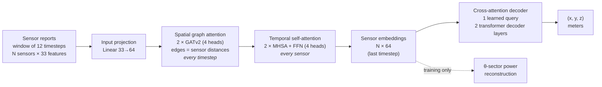

# STAGE

**Graph-temporal attention for 3D drone localization<br>
from the received-signal-strength reports of a sectorized ground-sensor network**

[Overview](#overview) •
[Installation](#installation) •
[Data](#data) •
[Pretrained models](#pretrained-models) •
[Training](#training) •
[Evaluation](#evaluation)


---

This is the official PyTorch implementation of **STAGE**. The repository
contains the model, the training and evaluation pipeline, and the
pretrained checkpoint behind every result in the paper.

## Overview

A network of stationary ground sensors watches the sky. Each sensor reports
the power it receives from a drone's transmitter in each of its antenna
sectors. STAGE turns a short window of these reports into the drone's 3D
position.



Each timestep is a graph whose nodes are the sensors and whose edges carry
inter-sensor distances. GATv2 layers mix information across sensors at
each timestep, per-sensor self-attention integrates each sensor's history
over the window, and a single learned query cross-attends over the sensor
embeddings to regress (x, y, z). No layer depends on the number or order of
sensors, so a model trained on 10 sensors runs unchanged on arrays of 3 to
20. The pipeline localizes one drone per experiment.

## Installation

Python 3.9 or newer. For GPU training, first install the PyTorch build for
your CUDA version ([pytorch.org](https://pytorch.org/get-started/locally/)).
Then:

```bash
git clone <repository-url>
cd <repository-folder>
pip install .
```

This installs the `stage` command and its dependencies: torch ≥ 2.3,
torch-geometric ≥ 2.3, numpy, pandas, matplotlib and tqdm.

To recreate the exact environment that produced the paper's results:

```bash
pip install -r requirements.txt
```

## Data

The datasets are not distributed. All data in the paper was generated with
the UAV simulator, [`uav-sim`](https://github.com/jordanconradburton/UAV-simulation),
whose README documents the physical model, the generation options and the
dataset format. `stage` reads the dataset folders `uav-sim` writes directly.

The paper uses four conditions:

| Condition | What the sensors observe | `uav-sim` command |
|---|---|---|
| Clear terrain | Noise-free received power | `generate` |
| Occluded terrain | 1–5 obstacles per experiment block line of sight | `add-mountains` |
| Receiver noise | Thermal noise at a floor of −110, −100 or −90 dBm | `add-noise` |
| Sensor-count sweep | 3–20 sensors; evaluation only | `generate --sensors N` |

The training sets have 200,000 experiments and the test sets 5,000, with 10
sensors unless stated otherwise.

## Pretrained models

`models/` holds the checkpoint behind each result in the paper, one per
condition, with its 3D RMSE on the paper's test data:

| Checkpoint | Trained on | 3D RMSE (m) |
|---|---|:-:|
| `stage_clean_seed2.pt` | Clear terrain | 37.0 |
| `stage_mountains_seed1.pt` | Occluded terrain | 48.0 |
| `stage_noise_f110_seed2.pt` | Receiver noise, −110 dBm | 102.5 |
| `stage_noise_f100_seed2.pt` | Receiver noise, −100 dBm | 142.9 |
| `stage_noise_f90_seed1.pt` | Receiver noise, −90 dBm | 286.0 |

Evaluate one on a test set of its condition:

```bash
stage evaluate models/stage_clean_seed2.pt path/to/test/graphs/shard_000
```

## Training

```bash
stage train path/to/train --checkpoint_out checkpoint.pt
```

`path/to/train` is a dataset folder written by `uav-sim`. On the first run
its shards are combined and normalized; later runs reuse the result. The
defaults are the paper's settings:

```
--epochs          100     Number of epochs
--lr              1e-3    Adam learning rate (cosine schedule to 0)
--batch_size      64      Batch size
--window_size     12      Timesteps per input window
--stride          12      Timesteps between consecutive windows
--dropnode_rate   0.2     Probability of zeroing a sensor's features
--dropout         0.0     Dropout probability
--seed            2       Random seed
```

The architecture is fixed in [`stage/model/config.py`](stage/model/config.py).

## Evaluation

```bash
stage evaluate checkpoint.pt path/to/test/graphs/shard_000
```

`--stride 12` scores the end points of non-overlapping windows; the default, `--stride 1`, scores every timestep. Metrics, a predictions CSV and plots are written to `eval_output/<checkpoint name>/`.

To evaluate one checkpoint on several sensor counts with one summary table:

```bash
stage sweep models/stage_clean_seed2.pt path/to/sensor_sweep/sensors_* --stride 1
```

`stage <command> --help` lists every option.

## Code structure

```
├── models/                   pretrained checkpoints, one per condition
└── stage/
    ├── cli.py                the `stage` command (train / evaluate / sweep / combine)
    ├── train.py              training recipe
    ├── evaluate.py           test-set metrics, plots and predictions CSV
    ├── sweep.py              one checkpoint on several test folders, one summary table
    ├── checkpoint.py         checkpoint saving and loading
    ├── data/
    │   ├── combine.py        merges a dataset's shards into one training folder
    │   ├── layout.py         which feature blocks a dataset contains (from manifest.json)
    │   ├── preprocessing.py  feature normalization
    │   ├── labels.py         labels CSV → (exp_id, timestamp) → position lookup
    │   └── dataset.py        sliding-window dataset
    └── model/
        ├── config.py         architecture hyperparameters
        ├── encoder.py        STAGEEncoder: input projection, GATv2, temporal attention
        ├── decoder.py        CrossAttnPosHead: learned-query position decoder
        └── weight_init.py    weight initialization
```

## License

MIT. See [LICENSE](LICENSE).
